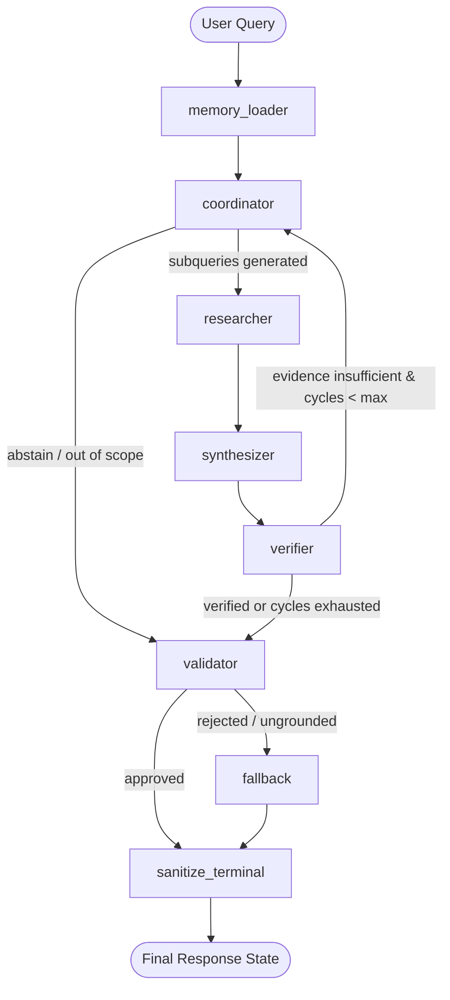

# Asterline Research Assistant — System Design Note

## 1. System Architecture & Agent Roles

Asterline Research Assistant is built as a deterministic, state-driven multi-agent research workflow powered by **LangGraph**, with strict evidence-grounding guardrails, single-writer SQLite user memory isolation, and privacy-preserving observability boundaries.

### Agent Roles & Responsibilities

| Agent / Node | Primary Responsibility | Input / Output Contract | Failure Handling |
| :--- | :--- | :--- | :--- |
| **`memory_loader`** | Loads active user memory preferences (`UserMemoryStore`) for the current `user_id`. | In: `user_id` Out: `user_memories: List[UserMemoryItem]` | Graceful fallback to empty memory list if database is uninitialized or user is anonymous. |
| **`coordinator`** | Deconstructs user query into targeted retrieval subqueries, incorporating memory context (e.g. user tier or platform). | In: `query`, `user_memories`, `research_cycle` Out: `subqueries: List[str]`, `user_memories: []` (sanitized immediately) | Enforces query boundary; if query is ambiguous or impossible, routes directly to validator for safe abstention. |
| **`researcher`** | Executes dense vector retrieval against local Chroma store (`all-MiniLM-L6-v2`) with cosine distance thresholding ($\le 0.70$). | In: `subqueries` Out: `evidence: List[EvidenceItem]` | Discards chunks with cosine distance $> 0.70$. Deduplicates chunks across subqueries. |
| **`synthesizer`** | Formulates candidate claims grounded strictly in retrieved evidence chunks. Extracts verifiable claim-to-chunk mappings. | In: `query`, `evidence` Out: `claims: List[Claim]` | If LLM encounters rate limits or upstream errors, records diagnostic error and yields empty claims for validator fallback. |
| **`verifier`** | Performs strict string-level and semantic verification of claim snippets against source chunk text. Identifies missing evidence and conflicting documents. | In: `claims`, `evidence` Out: `claims` (with verified citations), `conflicts: List[ConflictItem]` | Increments `research_cycle`. If verification reveals gaps and `research_cycle < 2`, loops back to Coordinator for targeted replanning. |
| **`validator`** | Acts as final deterministic gatekeeper. Enforces abstention thresholds and citation requirements. | In: `claims`, `conflicts`, `error_message` Out: `status: OutcomeStatus`, validated answer | Rejects ungrounded statements. If claims have 0 valid citations or conflicting timelines without resolution, triggers fallback abstention. |
| **`fallback`** | Constructs safe, non-hallucinated abstention responses when corporate evidence is insufficient or unverified. | In: rejection reason Out: Clear uncertainty notice with 0 citations | Guarantees system fails closed with zero ungrounded assertions. |
| **`sanitize_terminal`** | Terminal state scrubbing node. Ensures no internal prompt tokens, raw system memory, or secrets leak into output state. | In: intermediate graph state Out: Clean terminal state | Drops intermediate scratchpads and suppresses sensitive keys. |

---

## 2. Information Flow & Evidence Grounding

### Retrieval and Grounding Flow
1. **Query Decomposition:** The Coordinator translates natural language questions into 1 to 3 focused semantic search queries.
2. **Local Vector Search:** The Researcher queries local Chroma collections containing the 75 official chunks. No cloud embedding APIs are used; embeddings are generated locally using HuggingFace `all-MiniLM-L6-v2`.
3. **Evidence Filtering:** Retrieved chunks with cosine distance exceeding 0.70 are discarded to eliminate irrelevant noise.
4. **Verifiable Claim Mapping:** Synthesized claims must carry chunk ID pointers and verbatim supporting snippets. The Verifier inspects every snippet against raw chunk text. If a claim cannot be verified against chunk text, its citation is dropped.

### Handling Gaps, Conflicts, and Uncertainty
- **Missing Evidence (Abstention):** When the knowledge base lacks necessary facts, the Validator halts answer generation and emits an honest abstention (`INSUFFICIENT_EVIDENCE`), returning 0 citations.
- **Conflicting Documents & Timelines:** The corpus contains versioned policies (e.g., Launch plan storage limits changed between 2026-03-01 v1 and 2026-03-10 v3). The Synthesizer and Verifier analyze document publication dates (`published`) and version numbers (`version`). When conflicts exist, the system highlights the discrepancy or privileges the latest dated version, preventing outdated policies from being presented as active facts.
- **Uncertainty Presentation:** The UI explicitly differentiates verified evidence-backed claims from unresolved ambiguities or system errors.

---

## 3. Persistent User Memory Architecture

### Storage & Persistence
- User memory is managed by `UserMemoryStore` (`src/asterline/memory.py`) backed by a dedicated SQLite database (`data/asterline_user_memory.db`).
- Records persist across CLI sessions, Streamlit UI reloads, and application restarts.
- Memory schema records: `memory_id`, `user_id`, `key`, `value`, `status` (`active` vs `forgotten`), `version`, `created_at`, and `updated_at`.

### User Operations: Inspect, Correct, Forget
- **Inspect:** Users view their active memory records in the Streamlit sidebar table or CLI.
- **Correct (`remember`):** Updating an existing key increments its version, archives the previous state in history, and atomically updates the active record.
- **Permanent Wipe (`forget`):** When a user requests to forget a memory key, the system executes an immediate `DELETE` transaction removing both active and historical entries for that key, followed by SQLite `PRAGMA wal_checkpoint(TRUNCATE)`. Forgotten content is purged from database pages and WAL files.

### Memory Boundaries & Corporate Knowledge Isolation
- **Namespace Boundary:** All memory reads, writes, and deletions are strictly parameterized by `user_id`. Partial index `uq_user_memories_active_key ON user_memories(user_id, key) WHERE status = 'active'` prevents cross-user collisions.
- **Corporate Evidence Barrier:** Personal memory items are **never** indexed into Chroma, **never** passed to the Researcher, and **never** accepted as evidence by the Verifier. Memory can only influence Coordinator subquery focus (e.g., customizing "our team plan" to "Launch plan").
- **LangSmith Privacy Boundary:** Coordinator calls execute inside `suppress_tracing_boundary()`, suppressing child LLM trace spans so that personal memory tokens are never transmitted to cloud observability platforms. Furthermore, `coordinator_node` immediately empties `user_memories: []` in the state graph.

---

## 4. Architectural Choices, Trade-Offs & Limitations

1. **Cycle Limit Ceiling (Max 2 Cycles):**
   - *Choice:* Bounded research cycles ($N \le 2$).
   - *Trade-Off:* Prevents infinite loops and bounds latency/token consumption, but may abstain on multi-hop questions requiring $\ge 3$ retrieval hops.
2. **Deterministic Validator Gatekeeper:**
   - *Choice:* Rule-based Pydantic validator instead of an LLM self-evaluator.
   - *Trade-Off:* Guarantees that ungrounded or uncited claims cannot pass to the user regardless of LLM confidence, but strictly rejects nuanced claims if citation exactness fails.
3. **Local Embeddings vs Cloud Embeddings:**
   - *Choice:* Local `sentence-transformers/all-MiniLM-L6-v2` with Chroma.
   - *Trade-Off:* Complete data privacy, zero API costs, and 100% offline reproducibility, with slightly lower semantic capacity than larger cloud embedding models.
4. **Single-Writer SQLite Locking:**
   - *Choice:* File-backed SQLite for memory persistence.
   - *Trade-Off:* Zero operational infrastructure overhead, but concurrent writes from multiple processes are subject to filesystem locks.
5. **Provider Failure & Rate Limits:**
   - *Choice:* Safe provider wrappers with bounded retries, non-retryable 400 error detection, and a 10.0-second minimum deadline floor.
   - *Trade-Off:* Protects against invalid requests and cascading failures, but terminates with `PROVIDER_ERROR` when external providers face severe upstream throttling (e.g. free-tier 5 RPM).
