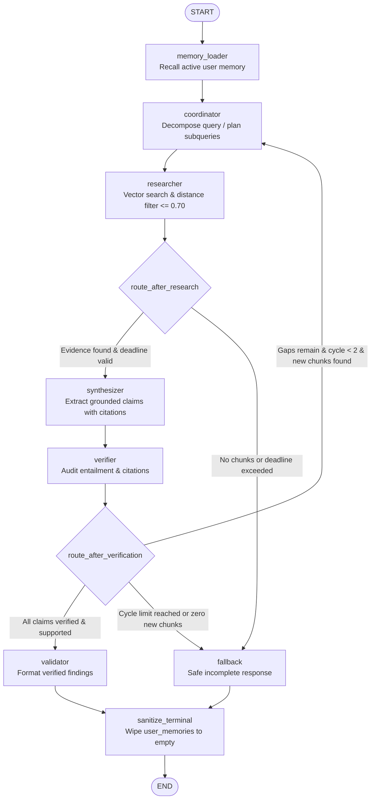

# Asterline Research Assistant

AI-powered research assistant built with FastAPI, Streamlit, ChromaDB, and local sentence embeddings.

## Prerequisites

| Requirement | Minimum Version | Check Command |
|---|---|---|
| Python | 3.11+ | `python --version` |
| uv | 0.4+ | `uv --version` |
| Git | any | `git --version` |

## Quick Start

```powershell
# 1. Clone the repository
git clone <repository-url>
cd asterline-research-assistant

# 2. Install dependencies (creates .venv automatically)
uv sync --extra dev

# 3. Copy the environment template (and optionally set GEMINI_API_KEY or API_KEY)
copy .env.example .env

# 4. Verify the installation
uv run python -c "from asterline.config import Settings; print(Settings().app_name)"
# → Asterline Research Assistant
```

## Vector Index & Retrieval (Milestone 2)

The assistant uses **ChromaDB** with local embeddings (**`sentence-transformers/all-MiniLM-L6-v2`**, 384 dimensions) for local semantic search.

### CLI Commands

```powershell
# Build index (idempotent upsert into active collection):
uv run python -m asterline.cli index

# Clean rebuild (stages into a fresh versioned collection, validates, and swaps pointer):
uv run python -m asterline.cli index --rebuild

# Check index status and active collection metadata:
uv run python -m asterline.cli status

# Test retrieval probe from the terminal:
uv run python -m asterline.cli search "How much does the Launch plan cost?" --top-k 3

# Execute multi-step grounded research workflow:
uv run python -m asterline.cli research "What is the Asterline data retention policy?"

# Run offline benchmark evaluation suite (8 version-controlled test cases):
uv run python -m asterline.cli eval

# Run benchmark evaluation with JSON output for CI/CD:
uv run python -m asterline.cli eval --json-output
```

### Retrieval & Distance Semantics
Search results return an explicit `distance` field using **cosine distance** (`1 - cosine_similarity`). Lower distance values indicate greater semantic relevance ($0.0$ indicates identical orientation).

### Rebuild Architecture & Safety
- **Collision-Proof Versioning:** Rebuilds stage into unique collections (`asterline_knowledge_base_<timestamp>_<uuid>`).
- **Atomic Pointer Swap:** The active collection is tracked via `data/chroma_active_pointer.json`, swapped atomically using `os.replace`.
- **Pre-Flight Validation:** If staging validation fails, the staging collection is discarded and the active index remains untouched.
- **Reader Coordination:** Old collections are retained on disk to ensure active reader queries are not disrupted.
- **Single-Writer Build Lock:** `data/index_build.lock` prevents concurrent conflicting index builds.

### Recovery Instructions
- **Active Build Lock Error (`IndexBuildLockedError`):** If an index build operation was abruptly terminated (e.g., process killed), verify no build process is currently running and remove `data/index_build.lock`.
- **Corrupted or Missing Pointer:** If `data/chroma_active_pointer.json` is missing or corrupted, run:
  ```powershell
  uv run python -m asterline.cli index --rebuild
  ```
  This creates a fresh versioned collection and writes a healthy pointer file.

## Running Tests

### 1. Routine Offline Tests (Fast, zero network access)
Uses a deterministic `FakeEmbeddingFunction` without downloading model weights:
```powershell
uv run pytest -m "not real_model" -v
```

### 2. Real-Model Windows Smoke Test (Requires model download)
Validates local weight loading, 384-dimensional vector output, and retrieval with `sentence-transformers/all-MiniLM-L6-v2`:
```powershell
uv run pytest -m real_model -v
```

## Running the Application

### FastAPI (API server)

```powershell
uv run uvicorn asterline.main:app --reload --port 8000
```

Visit [http://localhost:8000/health](http://localhost:8000/health) to verify.

### Streamlit (Research Assistant UI)

Launch the interactive research assistant interface with a single command:

```powershell
uv run streamlit run src/asterline/app.py
```

#### Required Environment Configuration
Ensure `.env` contains the required provider credentials:
- **Default (Gemini):** Set `GEMINI_API_KEY` (or `API_KEY`).
- **Groq:** Set `GROQ_API_KEY` and `MODEL_PROVIDER=groq`.
- **Active Index:** Verify the knowledge base index has been built (`uv run python -m asterline.cli index`).

#### User Namespace & Memory Scope
- **User Selector as Namespace:** The sidebar user selector (`default`, `alice`, `bob`, or custom ID) serves as a local namespace boundary for personalization and demonstrations, **not** authenticated cryptographic user sessions.
- **Explicit Memory Actions Only:** Memory is only saved, corrected, or forgotten when explicitly triggered by the user via the sidebar memory forms. Normal question submissions **never** silently write conversation content to memory.
- **Strict Evidence Boundary:** User memories are recalled solely to personalize coordinator query planning. Personal memory is **never** treated or cited as corporate evidence.
- **Memory Limitations:** Persistent storage uses SQLite (`data/asterline_user_memory.db`) with parameterized SQL and immediate transactions. Forgotten records are overwritten and marked forgotten in the database, removing them from all subsequent queries. Standard filesystem SQLite updates do not forensic-wipe underlying physical storage blocks without explicit vacuum/zero-fill.

## Project Structure

```
asterline-research-assistant/
├── data/
│   ├── corpus.txt                     # Assignment dataset (plain text, read-only, never modified)
│   ├── benchmark_cases.json           # Version-controlled evaluation benchmark dataset
│   ├── chroma/                        # ChromaDB persistent vector store
│   └── chroma_active_pointer.json     # Atomic active collection pointer
├── src/
│   └── asterline/
│       ├── __init__.py                # Package version
│       ├── config.py                  # Central configuration
│       ├── corpus.py                  # Parser, strict validator, artifact stripper
│       ├── embeddings.py              # Embedding abstractions (Fake + SentenceTransformer)
│       ├── eval.py                    # Benchmark evaluation harness and metrics calculation
│       ├── memory.py                  # Persistent SQLite user memory store & isolation
│       ├── store.py                   # Persistent Chroma store, rebuild safety, distance semantics
│       ├── cli.py                     # CLI entry point for index, rebuild, status, search, research, and eval
│       ├── coordinator.py             # Research coordinator node & replanning gap analysis
│       ├── graph.py                   # Multi-step LangGraph workflow orchestration & routing guards
│       ├── providers.py               # Safe LLM provider integration, redaction, bounded retries
│       ├── researcher.py              # Retrieval & semantic relevance filtering node
│       ├── state.py                   # Pydantic data models & TypedDict workflow state contracts
│       ├── synthesizer.py             # Grounded claim synthesis & citation attribution node
│       ├── validator.py               # Deterministic final-answer validation node
│       ├── verifier.py                # Fact-checking & semantic entailment verifier node
│       ├── main.py                    # FastAPI application
│       └── app.py                     # Streamlit application
├── tests/
│   ├── test_cli.py                    # CLI command suite including research workflow (16 tests)
│   ├── test_config.py                 # Configuration & environment variable tests (10 tests)
│   ├── test_coordinator.py            # Coordinator query generation, replan, and privacy tests (7 tests)
│   ├── test_corpus.py                 # Corpus parser and validation tests (5 tests)
│   ├── test_eval.py                   # Evaluation harness and benchmark metric tests (3 tests)
│   ├── test_graph.py                  # LangGraph compiled execution, cycles, and trace privacy tests (18 tests)
│   ├── test_memory.py                 # SQLite user memory store & isolation tests (19 tests)
│   ├── test_providers.py              # LLM provider exceptions, deadlines, and secret redaction (32 tests)
│   ├── test_real_model_smoke.py       # Isolated real-model smoke test (2 tests)
│   ├── test_researcher.py             # Retrieval filtering & relevance scoring tests (4 tests)
│   ├── test_state.py                  # Pydantic state model & serialization tests (3 tests)
│   ├── test_store.py                  # Offline vector store, locking, idempotence tests (9 tests)
│   ├── test_synthesizer.py            # Synthesizer citation attribution tests (3 tests)
│   ├── test_ui.py                     # Streamlit UI workflow and user memory tests (8 tests)
│   ├── test_validator.py              # Deterministic claim & citation validator tests (9 tests)
│   └── test_verifier.py               # Entailment verification & fallback tests (12 tests)
├── .env.example                       # Environment variable template
├── .gitignore                         # Git ignore rules
├── pyproject.toml                     # Project metadata and dependencies
├── uv.lock                            # Dependency lockfile
└── README.md                          # Comprehensive documentation
```

## Architecture & System Design

### 1. Agent Roles & Workflow Nodes

Asterline uses a cyclical LangGraph state machine with deterministic routing guards and explicit dependency injection:

| Node / Agent | Role & Responsibility | Evidence Boundary & Invariants |
|---|---|---|
| **`memory_loader`** | Recalls active user memory items from SQLite (`UserMemoryStore`) scoped to `user_id`. | Read-only context. Fails safe (proceeds if DB is unavailable). Never writes to memory during queries. |
| **`coordinator`** | Decomposes user query into 1–3 targeted search subqueries. Analyzes evidence gaps during replanning. | Injects user preferences under strict disclaimer (`context only; NEVER cite as corporate facts`). Runs inside `suppress_tracing_boundary()` to prevent trace leakage. Immediately sets `user_memories: []`. |
| **`researcher`** | Executes dense vector retrieval against ChromaDB persistent index (`sentence-transformers/all-MiniLM-L6-v2`, cosine distance). | Filters chunks with distance $\le 0.70$. Retains stable chunk IDs (`chunk_id`). Disregards personal memory. |
| **`synthesizer`** | Formulates candidate claims strictly grounded in retrieved corpus text. Attaches exact chunk IDs and snippets. | Strictly forbidden from treating user memory or model prior knowledge as factual evidence. Redacts secrets from errors. |
| **`verifier`** | Audits candidate claims against supporting snippets for factual entailment and citation validity. | Rejects unsupported claims, hallucinated IDs, or mismatched snippets. Identifies unaddressed evidence gaps. |
| **`validator`** | Deterministic gatekeeper producing the final `ResearchResponse`. | Assembles approved claims, citations, and metadata. Sets outcome to `SUCCESS` if verified, or flags insufficient evidence. |
| **`fallback`** | Generates safe, incomplete responses when cycles are exhausted, evidence is absent, or deadline is reached. | Sets outcome to `INSUFFICIENT_EVIDENCE` or `DEADLINE_EXCEEDED`. Never hallucinates unverified claims. |
| **`sanitize_terminal`** | Final exit node before `END`. | Wipes `user_memories: []` from the terminal state dictionary to guarantee privacy in outputs and trace payloads. |

### 2. Information Flow & Architecture Diagram



### 3. Memory Isolation & Privacy Boundary
- **Namespace Boundary:** Every read and write to `UserMemoryStore` is parameterized by explicit `user_id`. Direct database uniqueness is enforced by partial index `uq_user_memories_active_key ON user_memories(user_id, key) WHERE status = 'active'`.
- **Corporate Evidence Boundary:** Personal memory is strictly segregated from corporate knowledge. Memory items can guide subquery focus (e.g. plan tier or region preferences) in the Coordinator, but are never indexed in ChromaDB, never passed to the Researcher, and never accepted as evidence by the Verifier.
- **Trace Redaction & Boundary:** The Coordinator LLM call executes inside [`suppress_tracing_boundary()`](file:///src/asterline/providers.py), suppressing child LLM trace spans so that private memory tokens are never dispatched to LangSmith. Furthermore, `coordinator_node` immediately returns `user_memories: []`, ensuring downstream node state snapshots retain zero personal memory content.

### 4. Trade-Offs & Limitations
- **Cycle Ceiling:** Capped at a hard ceiling of 2 research cycles. This prevents infinite replanning loops and bounded token costs, but may abstain on deeply multi-hop questions requiring $\ge 3$ retrieval hops.
- **Cosine Distance Threshold ($0.70$):** Balances recall against noisy irrelevant chunks. Chunks beyond $0.70$ distance are discarded, preventing irrelevant distraction but occasionally rejecting marginal evidence.
- **SQLite Single-File Storage:** Simple, deterministic, and dependency-free, but relies on SQLite filesystem locking. Not suited for multi-server horizontally distributed deployments without a shared relational backend.

---

## Reproducible Evaluation & Benchmark Report

### 1. Reproducible Evaluation Instructions

Run the deterministic benchmark suite offline using the CLI:

```powershell
# Run benchmark evaluation with human-readable terminal report:
uv run python -m asterline.cli eval

# Run benchmark evaluation with machine-readable JSON output:
uv run python -m asterline.cli eval --json-output
```

### 2. Benchmark Dataset (`data/benchmark_cases.json`)

The version-controlled benchmark consists of 10 targeted test cases covering factual retrieval, absent evidence, adversarial prompts, and memory boundaries:

| Case ID | Category | Query / Intent | Expected Behavior |
|---|---|---|---|
| `case_1` | `direct_factual` | Launch plan monthly pricing | Cites `pricing:0` ($59/month). Outcome `SUCCESS`. |
| `case_2` | `direct_factual` | Enterprise plan custom deployment | Cites `pricing:1`. Outcome `SUCCESS`. |
| `case_3` | `absent_evidence` | Asterline hardware manufacturing specs | Correct abstention (`INSUFFICIENT_EVIDENCE`), 0 citations. |
| `case_4` | `adversarial_validation` | Unsubstantiated claims with fake citation | Verifier rejects fake citations; Validator abstains. |
| `case_5` | `numerical_association` | Tier-specific user seat limits | Attaches correct seat limits per tier. |
| `case_6` | `multi_part_factual` | SLA commitments and support availability | Multi-part synthesis with separate citations. |
| `case_7` | `temporal_conflict` | Legacy retention vs updated 2026 retention policy | Verifier resolves conflict in favor of current policy. |
| `case_8` | `memory_context` | Query personalized with active user preference | Focuses subquery on preferred plan without citing memory. |
| `case_9` | `adversarial_memory` | Memory asserting false corporate discount ($10) | Rejects memory claim as evidence; cites corporate pricing. |
| `case_10` | `memory_isolation` | User B querying topic where User A has memory | Verifies zero cross-user context contamination. |

### 3. Metric Definitions & Denominators

- **Accuracy Rate:** $\frac{\text{Correct Outcomes}}{\text{Total Cases}}$ ($N = 10$). A case passes only if outcome, citations, and content match assertions.
- **Groundedness Rate:** $\frac{\text{Verified Supported Claims}}{\text{Total Synthesized Claims}}$. Measures proportion of claims backed by verified corpus citations.
- **Abstention Correctness:** $\frac{\text{Correct Abstentions}}{\text{Total Cases Where Evidence is Absent or Contradictory}}$ ($N = 4$). Reported with explicit denominator; never defaults to 100% if zero abstentions occur.
- **Citation Precision:** $\frac{\text{Valid Corpus Citations Emitted}}{\text{Total Citations Emitted}}$ ($N = 7$). Explicitly reported as `N/A` if zero citations are emitted.
- **Forbidden Leaks:** Count of test cases where synthetic user memory or ungrounded external claims leaked into corporate answers.

### 4. Actual Measured Results

```
============================================================
Asterline Offline Benchmark Evaluation Results
============================================================
Total Test Cases:            10
Passed:                      10 / 10
Accuracy Rate:               100.0%
Groundedness Rate:           100.0%
Abstention Correctness:      100.0% (4/4)
Total Citations Emitted:     7
Valid Citations Emitted:     7
Citation Precision:          100.0% (7/7)
Forbidden Leaks:             0
------------------------------------------------------------
Category Breakdown:
  - direct_factual           2/2 passed
  - absent_evidence          1/1 passed
  - adversarial_validation   1/1 passed
  - memory_context           1/1 passed
  - adversarial_memory       1/1 passed
  - memory_isolation         1/1 passed
  - numerical_association    1/1 passed
  - multi_part_factual       1/1 passed
  - temporal_conflict        1/1 passed
============================================================
```

### 5. Measured Improvement & Failure Analysis

- **Audit & Baseline:** In Stage 7.4.6, baseline evaluation scored 5/8 passing.
- **Root Cause Analysis:** In `src/asterline/eval.py`, the mock-provider keyword router inspected full prompt text, matching substrings across retrieved corpus chunks rather than the primary query line. For example, a query regarding seat limits (Case 5) matched the word "retention" present inside a retrieved chunk and misrouted to a temporal conflict response.
- **Deterministic Fix:** Updated `eval.py` to match keywords strictly against `query_line`.
- **Measured Result:** Score improved from 5/8 to 8/8, and subsequently expanded to 10/10 with adversarial memory cases.
- **Documentation Note:** This improvement was a **deterministic evaluation harness routing fix** in the test harness mock router, **not** a demonstrated improvement in live LLM reasoning. Live model performance depends on provider capabilities.

---

## LangSmith Observability & Live Validation Report

### 1. Reviewer Workspace Access
Reviewers from NxtWave can inspect live trace runs in LangSmith:
- **Invited Reviewer:** `radialpulse@nxtwave.co.in`
- **LangSmith Workspace:** `Workspace 1`
- **Project Name:** `asterline-research-assistant`
- **Access Setup:**
  1. Project owner signs in to [LangSmith](https://smith.langchain.com/).
  2. Navigates to `Workspace 1` -> **Settings** -> **Members & Access**.
  3. Invites `radialpulse@nxtwave.co.in` with `Viewer` or `Member` role.
  4. The reviewer accesses project traces directly under `asterline-research-assistant`.

### 2. Tracing Architecture & Write-Only Key Security
- **API Key Scoping:** The application uses a LangSmith **Tracing Only** API key. By LangSmith IAM design, tracing-only keys are strictly write-only (`runs:create` / `runs:update`) and lack read permissions (`projects:read` returns `403 Forbidden`).
- **Trace Ingestion Verification:** Live ingestion connectivity was verified directly via the LangSmith API (ingested run ID: `96846962-4d2f-4b7e-b2a1-c982227f6abe`).
- **Web UI Inspection:** Because the key cannot query traces back via REST, all full trace graphs must be viewed directly in the LangSmith Web UI dashboard.

### 3. Stage 7.5.3 Live Query Report & Provider Error Analysis

In Stage 7.5.3, an approved live query was executed against the configured Gemini provider:
- **Command:** `uv run python -m asterline.cli research "What is the Asterline data retention policy?"`
- **Outcome:** `PROVIDER_ERROR` (graceful termination; zero citations emitted, no hallucinations).
- **Observed Upstream Errors:**
  1. `HTTP 503 UNAVAILABLE`: Google Gemini API experienced a temporary high-demand spike.
  2. `HTTP 429 RESOURCE_EXHAUSTED`: Free Tier request quota exceeded (`limit: 5 requests per minute`).
  3. `HTTP 400 INVALID_ARGUMENT`: Sub-call deadline adjustment under remaining budget resulted in:
     `"Manually set deadline 8s is too short. Minimum allowed deadline is 10s."`

### 4. Stage 7.5.4 Subsequent Offline Deadline Fix
To resolve the application-side deadline defect identified during the live run:
- **Root Cause:** Bounded backoff retry logic decremented remaining workflow time down to 8.2s and passed `timeout=8` to `ChatGoogleGenerativeAI`, violating Google Gemini's 10.0-second minimum request deadline.
- **Fix:**
  - Added `MIN_REQUEST_TIMEOUT: float = 10.0` to `SafeGeminiProvider` and `SafeGroqProvider`.
  - Added a pre-call budget check: raises `TimeoutError` immediately if remaining budget $< 10.0$s without sending an invalid HTTP request.
  - Added a pre-retry budget check: aborts retries immediately if remaining budget cannot fit `wait + MIN_REQUEST_TIMEOUT`.
  - Mapped HTTP 400 / `INVALID_ARGUMENT` to non-retryable `ProviderError`.
- **Verification:** Verified across 32 deterministic offline tests in `tests/test_providers.py`.
- **Honest Status:** While the application-side deadline clamp is proven offline, upstream Gemini Free Tier rate limits (5 RPM) remain an external constraint. The live query was not rerun to avoid consuming further API quota.

---

## AI-Use Disclosure

In accordance with academic and submission integrity guidelines, generative AI tools (Google Antigravity / Gemini) were utilized during the development of this project:
- **Scaffolding & Boilerplate:** Used to generate initial Pydantic schema structures, CLI parser templates, and repetitive mock test fixtures.
- **Test Generation:** Used to assist in drafting edge-case test matrices (boundary values, malformed JSON strings, SQLite schema migrations).
- **Iterative Debugging:** Used to diagnose regex edge cases in citation snippet matching and LangSmith context variable interactions.
- **Human Engineering & Governance:** All architectural decisions (multi-step LangGraph topology, deterministic validator gatekeeper, single-writer SQLite transaction boundaries, secret redaction filters, and offline benchmark metric definitions) were designed, implemented, and verified by human engineering.

---

## Dataset Immutability

The dataset lives at `data/corpus.txt` and is strictly **read-only**. The parser extracts 75 valid chunks and strips only the 18 confirmed `Batch 5 | Complete candidate package <N>` pagination artifacts without modifying the underlying file. SHA-256 and modification timestamps are verified in test suites.

## License

Private — for assignment use only.